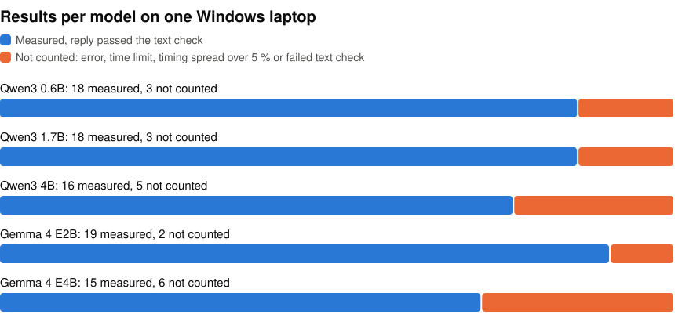

# LLMs on one Windows PC

I tested five small LLMs on one Windows laptop in November 2026, to see which runtimes and processors can run them, how fast, and in how much memory. That gave 105 results, 21 per model.

<p align="center">
<picture>
  <source media="(prefers-color-scheme: dark)" srcset="https://raw.githubusercontent.com/john-rocky/windows-llm-zoo/main/docs/images/results-dark.svg">
  
</picture>
</p>

A result counts when the model ran, its speed held within 5 % across repeated runs, and its reply passed a text check. A reply passes when it has at least 10 different words, mentions the prompt's topic and does not keep repeating itself. The check does not compare the answer with the original model's.

- **Models:** Qwen3 0.6B, 1.7B and 4B, Gemma 4 E2B and E4B
- **Runtimes:** LiteRT-LM v0.19.0, llama.cpp b11721, ONNX Runtime GenAI 0.19.0, Foundry Local 0.13.0, OpenVINO GenAI 2026.4.1
- **Processors:** the CPU, Intel GPU and Intel NPU of a Core Ultra 9 386H, and an RTX 5080 Laptop GPU
- **PC:** MSI Stealth 16 AI+, 31.5 GB of memory, Windows 11 Home

Every run used the same short chat prompt, greedy decoding and at most 128 new tokens. Speeds are the median of repeated runs, each timing the first generation in a fresh process.

## Look up a result

Browse [`results/`](results/) by model. Each file is one combination of runtime, processor and backend, such as CUDA or WebGPU. For example, [`results/gemma-4-E2B-it/openvino-genai_igpu_gpu.json`](results/gemma-4-E2B-it/openvino-genai_igpu_gpu.json) is Gemma 4 E2B on OpenVINO GenAI on the Intel GPU: 31.87 tokens per second, 1,246 ms to the first token and a peak of 4,665 MiB. Each file also names the Hub repo and the quantization, and [`shelf/hub_manifest.json`](shelf/hub_manifest.json) has the exact revision of every file.

To see all the results in one table on a Windows machine, clone the repo and run this. It needs only Python's standard library:

```bat
git clone https://github.com/john-rocky/windows-llm-zoo
cd windows-llm-zoo
python tools\table.py
```

It writes `RESULTS_LLM_WINDOWS.md`, with 130 rows: the 105 results and 25 combinations I did not run, each with the reason. On a Mac, the last command is `python3 tools/table.py`.

## NPU builds on Hugging Face

I exported four of the models for the Intel NPU. Each card has the export command and this laptop's NPU numbers:

- [Qwen3 0.6B](https://huggingface.co/mlboydaisuke/Qwen3-0.6B-int4-sym-g128-ov)
- [Qwen3 1.7B](https://huggingface.co/mlboydaisuke/Qwen3-1.7B-int4-sym-g128-ov)
- [Qwen3 4B](https://huggingface.co/mlboydaisuke/Qwen3-4B-int4-sym-g128-ov)
- [Gemma 4 E4B](https://huggingface.co/mlboydaisuke/gemma-4-E4B-it-int4-sym-cw-ov)

Gemma 4 E2B ran from [OpenVINO's own build](https://huggingface.co/OpenVINO/gemma-4-E2B-it-int4-cw-ov).

## More

- [How the results are measured](docs/measuring.md)
- [The method](PLAN.md), in Japanese
- [Run everything from an empty folder](docs/reproduce.md), with scripts that drive the PC from a Mac over ssh
- [Notes from the November 2026 run](docs/run-2026-11-07.md)
- [What each folder holds](docs/files.md)

## Licences

Each model and runtime has its own licence. See [LICENSES.md](LICENSES.md).
